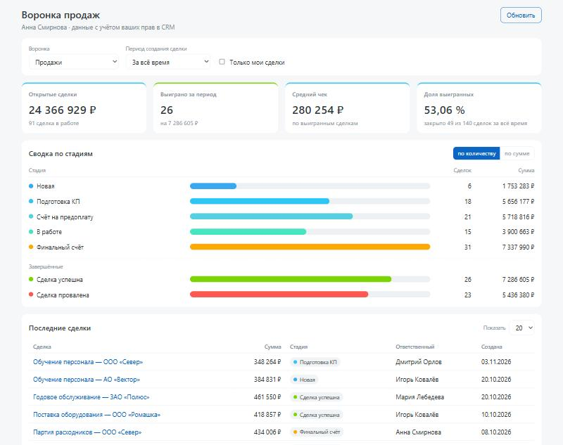

# Дашборд воронки продаж — описание решения

**Приложение:** https://app-26188ffe6f25.vibecode.bitrix24.tech (открывается после входа через Битрикс24; без входа шлюз отвечает 401)
**Где открывается:** Битрикс24 → левое меню → «Воронка продаж».
**Исходный код:** https://github.com/zhirkovd-zde/b24-funnel-dashboard — ключей и секретов в нём нет.



*Скриншот сделан на выдуманных данных (`npm run dev`), чтобы не публиковать сведения клиентов портала.*

## Назначение и сценарии

Приложение встраивается в портал Битрикс24 и показывает аналитику по сделкам CRM **от лица сотрудника, который его открыл** — с его правами доступа на портале.

1. **Сводка по стадиям воронки** — количество сделок и сумма по каждой стадии (`stageId`) выбранной воронки, полосы по количеству или по сумме; завершённые стадии (успех и провал) показаны отдельно.
2. **Ключевые показатели** — сумма и число открытых сделок, число и сумма выигранных за период, средний чек (сумма выигранных ÷ их число), доля выигранных среди закрытых (выиграно ÷ (выиграно + проиграно)).
3. **Последние сделки** — 10 или 20 последних созданных: название (ссылка на карточку сделки), сумма, стадия, ответственный, дата создания.
4. **Фильтры** — период создания сделки (быстрые варианты и свой диапазон дат с проверкой), воронка, «Только мои сделки».

## Скоупы и зачем каждый

Ключ авторизации приложения (`vibe_app_`, запросы от лица пользователя):

| Скоуп | Зачем |
|---|---|
| `crm` | чтение сделок, стадий и воронок; агрегация количества и сумм по стадиям |
| `user` | имена ответственных в таблице последних сделок (`user_brief` раздел сотрудников не открывает) |
| `placement` | встраивание приложения в интерфейс Битрикс24 (пункт левого меню) |

Ключ приложения выпущен в режиме **«Только чтение»**: любая запись блокируется платформой (`403 WRITE_BLOCKED_READONLY_KEY`), скоупы Вайбкод (`vibe:*`) у него сняты.

Для выкладки — **отдельный** личный ключ `vibe_api_` с единственным скоупом `vibe:infra` (сервер и выкладка), сроком 30 дней. Данных Битрикс24 он не читает.

Фактические наборы сверены через `GET /v1/me` (`node deploy/deploy.mjs me`, срез — [docs/v1-me.json](docs/v1-me.json)): ключ приложения — тип `oauth_app`, `accessMode: READONLY`, скоупы `crm, user, placement`; ключ выкладки — тип `personal`, скоуп `vibe:infra`.

## Как устроена безопасность

- **Модель доступа:** ключ авторизации + токен сессии пользователя из заголовка `X-Vibe-Authorization`, который проставляет Gateway. Каждый сотрудник видит только то, что ему разрешено в CRM; личность берётся из `GET /v1/me`, а не из параметров браузера.
- **BFF:** браузер ходит только к своему серверу (`/api/*`); ключ приложения живёт в переменной окружения сервера, токен сессии в браузер не попадает.
- **Сервер** — отдельная виртуальная машина в режиме Black Hole (снаружи доступна только через шлюз платформы), засыпает после 60 минут простоя; политика доступа меняется только решением владельца; приложение слушает порт 3000 под непривилегированной учётной записью; внешних зависимостей нет (`npm install` не нужен). Ключ приложения передан в окружение сервера (`.env` с правами 600), в коде и архиве его нет; каждая выкладка сохраняет версию исходников на платформе.
- **Данные:** запрашиваются только нужные поля (`select`) и только под фильтр; сделки не кэшируются; в журнал пишутся метод, путь, статус и код ошибки — без параметров фильтра, имён и содержимого сделок. Справочники (воронки, стадии, имена сотрудников) кэшируются в памяти на 5–10 минут **отдельно для каждого пользователя** (ключ — портал + пользователь, подтверждённый `GET /v1/me`): ответ, полученный с правами одного сотрудника, другому не отдаётся.
- **Ввод** проверяется на сервере: формат и существование дат, порядок «с ≤ по», номер воронки из списка портала, допустимые значения остальных параметров.
- **Ошибки API:** 429 — повтор с паузой 1 → 2 → 4 с (или по `Retry-After`); 502 — один повтор; временные ошибки отдельных подвызовов `batch` (429, 502–504, `QUERY_LIMIT_EXCEEDED`) повторяются с той же паузой только для упавших подвызовов, отказ по правам (403) не повторяется; 401/403 — понятное сообщение без технической трассы (и по коду, и по HTTP-статусу). После ошибки старые цифры убираются с экрана. Пустые данные — явное «сделок нет». Если стадии нельзя классифицировать (справочник недоступен по правам или из-за сбоя, либо сделка стоит на стадии вне справочника), показатели открытых и выигранных показываются как «—» с предупреждением, а не как ноль; сводка по кодам стадий и последние сделки остаются.
- **Лимиты:** одна загрузка — 2–3 запроса: `POST /v1/deals/aggregate` с `groupBy: stageId` вместо выгрузки всех сделок и `POST /v1/batch` для последних сделок, стадий и имён.

## Известные ограничения

- Фильтр периода — по **дате создания** сделки; «выиграно за период» — созданные в периоде и сейчас стоящие на стадии успеха.
- Суммы складываются в валюте сделок **без пересчёта курсов**; на мультивалютном портале итог условен.
- Платформа считает суммы не более чем по 5000 сделкам под фильтр. Если сделок больше — показывается предупреждение (или только количество), нужно сузить период.
- Сессия пользователя живёт 24 часа; после неё приложение просит открыть его заново из меню.
- Сервер засыпает после 60 минут простоя: первое открытие после сна занимает до минуты.
- Ссылка на сделку открывает карточку в основном окне Битрикс24 (SDK `BX24` за обработчиком Вайбкод недоступен).
- Если имя ответственного недоступно (например, сотрудник уволен или скрыт), вместо имени показывается «Сотрудник #ID».

## Инструкция для проверяющего

Приложение развёрнуто на портале автора с политикой доступа «только владелец»: открыть его другим людям — решение владельца данных, а не разработчика (принцип памятки о `accessPolicy`). Поэтому проверить можно тремя способами.

**А. Без портала, за 1 минуту** (нужен Node.js 22+):

```bash
npm test        # 52 автотеста: расчёты, фильтры, ошибки API, пустые данные, права двух пользователей
npm run dev     # http://localhost:3000 — интерфейс на выдуманных данных
```

Сценарии имитации: `MOCK_SCENARIO=nostages` (нет доступа к стадиям), `empty` (портал без сделок), `huge` (слишком много сделок для сумм), `partial` (усечённая агрегация), `error` (Битрикс24 недоступен).

**Б. На своём портале** — по шагам из [README.md](README.md), раздел «Развёртывание с нуля» (около 15 минут).

**В. На портале автора** — по запросу автор добавит проверяющего в список доступа сервера.

Что проверить в интерфейсе:

1. Откройте портал → левое меню → **«Воронка продаж»** (при первом открытии Битрикс24 попросит разрешить доступ приложению).
2. Проверьте показатели и сводку; переключите «по количеству / по сумме».
3. Смените период: «Прошлый месяц», «Свой период…» (дата «с» позже «по» — увидите ошибку без запроса к серверу).
4. Отметьте «Только мои сделки», смените воронку, число строк в таблице.
5. Выберите период без сделок (например, 2001 год) — пустое состояние без ошибок.
6. Клик по названию сделки открывает её карточку.
